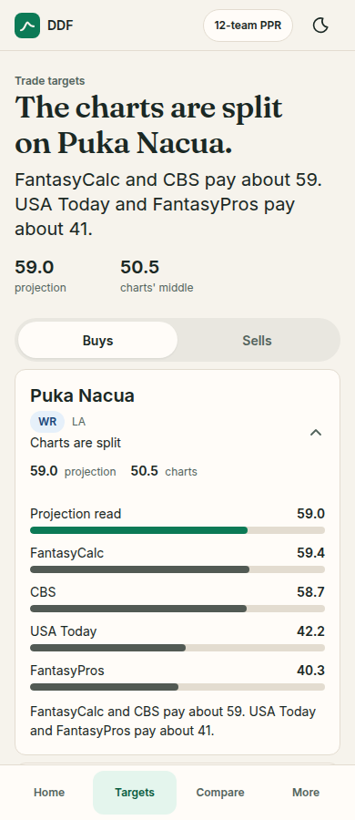
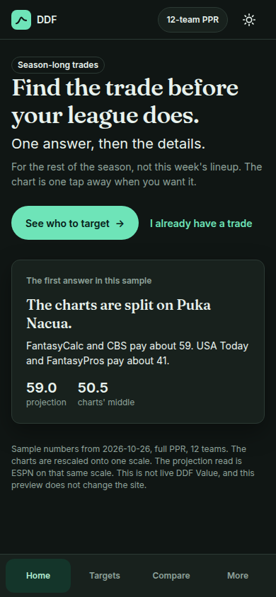

# Design direction, October 2026

Proposal for Jeremy. Nothing here ships. The live site is unchanged. The clickable preview that shows the recommendation is `app/v2-concept/index.html`. It is a separate page. `pipelines/build_v2_page.py` copies a named list of files out of `app/v2/`, so this folder is not part of the publish.

Last updated: 2026-10-26. Status: Proposal.

## The feeling

Data Driven Football should feel like a sharp friend who already did the reading. Warm, direct, a little playful in how a screen moves, and serious the moment a number is on it.

A casual player gets one sentence and one button. A serious redraft manager gets the charts one tap later. Jeremy's own leagues use the same door, with the league in one chip. Someone arriving from ChatGPT or Claude should see the same kind of sentence the assistant would say, with the detail underneath.

The forest green stays. It is already the brand, and it already passes contrast. What changes is the density, the type, and where the expert tools sit.

Patterns borrowed from friendlier tools: Sleeper's calm first screen, KeepTradeCut's one trade with a verdict, FantasyCalc's "here is the trade" focus. The density of a full research table stays available. It stops being the front door.

## The first 10 seconds

On a 390px phone, measured in this preview at 390×844:

1. The headline starts just over 100px from the top of the viewport (106px in the click-through check). The review's problem was a title starting near 700px, under the season notice, the league bar, the default-league notice, and the sources bar. Those four bars are gone from the front door.
2. You read one sentence, "Find the trade before your league does," and you see one green button, "See who to target."
3. A card on that same screen already tells the week's story. In this sample: the charts are split on Puka Nacua.
4. You tap. The next screen rises into place. The same sentence is now the title, with two numbers under it, and a list you can open.

The league is a chip in the header, "12-team PPR." Tap it and the season note lives there: rest of the season, not start/sit, not playoffs. It is one sentence in a sheet, not a banner above the answer.

## What moves off the front door

The front door is three places: Home, Targets, Compare. A fourth item, More, holds the rest.

Also for you, still one tap away: Player values, Risers and fallers, Waivers, Find a trade.

The desk: Values auditing, Overrides, and Writing. They stay in the product. They are how the work gets checked. They do not sit in the main nav.

Find a trade is where fit words belong (Natural, Value, Market, Force). Casual screens in this preview say Buy, Sell, Ahead, Behind, Close, and Split. The glossary disagreements in `docs/product/fit-label-glossary-draft.md` are a content decision. This direction does not pick them. It only says: when those words appear, they are the one chip, and they appear on Find a trade.

The site's own value has several public names today (DDF Value, the projections version, ESPN, CBS rest of season, Razzball, and the charts version of the same series). The recommendation is one public name on a casual screen: **DDF Value**. The other names show up after you expand, each labeled by what it is. This preview does not compute DDF Value, so it does not pretend to. It labels the two numbers it does have.

## Tokens

The type scale is the Figma scale: 34, 28, 20, 14, 12. Nothing else. This preview uses 34 for the answer, 20 for a name or the sentence under the answer, 14 for body, and 12 for metadata. 28 stays in the scale for a secondary page title. The preview screens lead with 34, so 28 is unused here.

UI text is Inter. The answer is Fraunces, a soft serif, vendored under the SIL Open Font License (`app/v2-concept/fonts/`). Numbers stay in Inter, tabular, so they still read as data.

Spacing steps by 8. Phone page padding is 16. Cards are 12px radius. The one main button, the chips, and the search field are pills, so a control feels like one family. Hit targets on the preview's buttons are at least 44px.

Color, light:

| Token | Value | Use |
|---|---|---|
| Canvas | `#F6F3EC` | Warm paper |
| Surface | `#FFFCF8` | Cards |
| Ink | `#1A2824` | Text |
| Muted | `#52635C` | Metadata |
| Line | `#E3DCD0` | Hairlines |
| Action | `#0C7A56` | The one button, and the projection bar |
| Action ink | `#FFFFFF` | Text on that button |

Good, warn, bad, and info are tint plus ink pairs (`#E4F5ED` / `#085C40`, `#F8EFE1` / `#7A4510`, `#F8E8EA` / `#8C2434`, `#E6F0FA` / `#18467A`). Each pair was checked at 4.5:1 or better on its own background. Dark mode uses the same roles: canvas `#101614`, surface `#18211D`, ink `#E8F2ED`, action `#6EE4B8` with ink `#062018`.

Green is used twice on a screen: the button, and the bar that marks the projection read. Chart bars are ink. Position is not a new color system. It is the same chip with a tone (RB good, WR info, TE warn, QB neutral).

## One chip

Every label is the same component: 12px, semibold, pill, 24px tall.

| Tone | Examples in the preview |
|---|---|
| Neutral | Season-long trades, Sample |
| Good | A buy, an RB |
| Info | A WR |
| Warn | A TE |
| Bad | Reserved for a clear loss, when a chip needs it |

The two big numbers under a headline are figures, not chips. They have a label ("projection", "charts' middle") and no badge chrome.

## Motion

One duration, 200ms, on a soft ease (`cubic-bezier(0.2, 0.7, 0.2, 1)`). That sits inside the 150–250ms range.

- A tab or page change rises 8px and fades in.
- A card opens by animating its height. The chevron turns.
- A verdict or a headline cross-fades when the number changes.
- The Buys/Sells thumb slides. The desktop nav underline draws.
- A button nudges its arrow on hover, and presses in slightly on tap. Hover styles are wrapped in `@media (hover: hover)` so they do not stick on a phone.

`prefers-reduced-motion: reduce` sets the duration to 0ms. There is no `!important`. The preview's stylesheet has none. Production `v2.css` still has its `!important` pile. That cleanup belongs with the production pass, not this preview.

## The three screens

**Home.** One sentence, one button, a text link for people who already have a trade, and a card that previews the first answer. On a wide screen the card sits beside the sentence. On a phone it sits under the button, still in the first viewport.

**Trade targets.** The title is the answer. "The charts are split on Puka Nacua." Two figures sit under it. Buys and Sells are one control. Each row is a person, a position chip, a short line, and the two numbers. Open a row for the four charts as bars. The green bar is the projection read.

**Compare.** The title is the verdict. The sample trade is Puka Nacua for Jaxon Smith-Njigba: "Close for the charts. Not for the projection read." Change either player and the sentence updates. "Show the charts" opens the four publishers under that sentence. Clear starts from empty: "Add a player to each side."

More and the league chip open sheets. They explain where the other tools go. They are not extra product screens.

## The numbers in the preview

They are real, and they are not live DDF Value.

`app/v2-concept/build_sample.py` reads `dist/modules/player-trace.json` (generated 2026-10-26) and names, positions, and teams from `data/fixtures/current/players.json`. The chart values are `fixture_reindexed` for full PPR, 12 teams. FantasyCalc is stored on `full_12_qb1`. The projection read is the ESPN series on that same rescaled scale. ESPN tops out at 70 in this fixture. Other charts can sit higher. Jahmyr Gibbs is on that ceiling, so his lead is a floor, and he is not the featured sentence.

The featured buy is the clearest split that is not on the ceiling: Puka Nacua. FantasyCalc 59.4 and CBS 58.7, USA Today 42.2 and FantasyPros 40.3, projection read 59.0, charts' middle 50.5. The featured sell is Chris Olave: every chart pays more than the projection read (24.4 vs a middle of 34.9).

Quarterbacks are left out of the sample. On the 1QB chart scale a raw gap against the ESPN anchor overstates the lead.

Two cuts exist only so the preview has a calm list and a calm sentence. They are not proposed changes to the trade math:

- A player is listed when the charts form two camps, or the gap between the projection read and the charts' middle is at least 2.5.
- Compare calls a side "about even" when the gap is under 2 points on this scale.

Regenerate with `python3 app/v2-concept/build_sample.py` from the repo root. Do not hand-edit `sample.js`.

## What this is not

- It does not change `app/v2/shell.html`, `v2.css`, `v2.js`, or the production tab files. Another session is cleaning those.
- It does not run the value engine, and it does not mount the hidden legacy engine. The production page's weight (every tab carrying that engine) is an engineering job of its own. This preview simply is not that page.
- It does not pick the fit-label glossary, and it does not rename DDF Value in production.
- It does not publish. Opening the file, or serving the repo, is the whole preview.

## Screens

Shots at 390 and 1280, light and dark, are in `docs/design/shots/`. A few of them:

The same folder also has dark shots of Targets and Compare, the sell list, the opened charts on Compare, and the More sheet.

## Decisions for you

The preview is drawn as the recommended option in each case, so you can see it. Reject any line and the rest still stands.

1. **Type.** A) Fraunces for the one headline, Inter everywhere else. Recommended. The serif is the only playful note, and the numbers stay in Inter. B) All Inter, at the same sizes. C) A geometric sans for the headline.

2. **Canvas.** A) Warm paper `#F6F3EC`, with the same forest ink and green. Recommended. B) Keep today's `#F3F7F7`.

3. **Front door.** A) Home, Targets, Compare, and More. Auditing, Overrides, and Writing live under More, in a desk group. Recommended. B) Those three, plus Player values as a fourth top item. C) Restyle only, and keep today's tabs.

4. **First screen.** A) A landing with one action, and a peek of the answer, which is what the preview shows. Recommended. B) Skip the landing and open on Targets, with the same headline treatment.

5. **Our number's name.** A) One public name, DDF Value, on every casual screen. The other names appear after expand, each labeled by what it is. Recommended. This preview does not show a DDF Value, because it does not run the engine. B) Keep the version names in the header.

6. **Fit words on casual screens.** A) Casual screens say Buy, Sell, Ahead, Behind, Close, Split. Find a trade keeps Natural, Value, Market, and Force, drawn as the one chip, after the glossary is settled. Recommended. B) Show the four fit words on Targets and Compare too.
