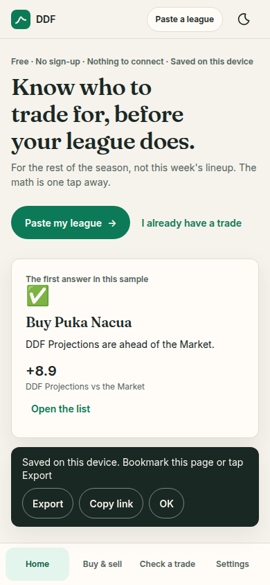
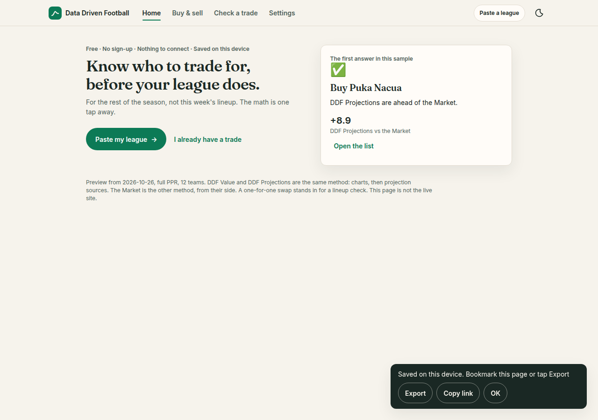
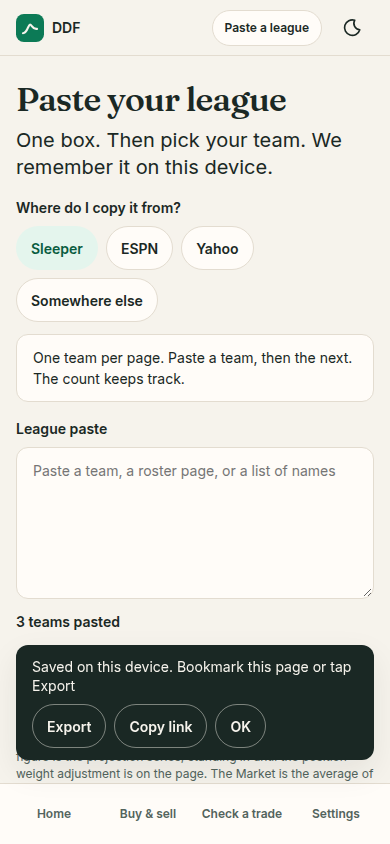
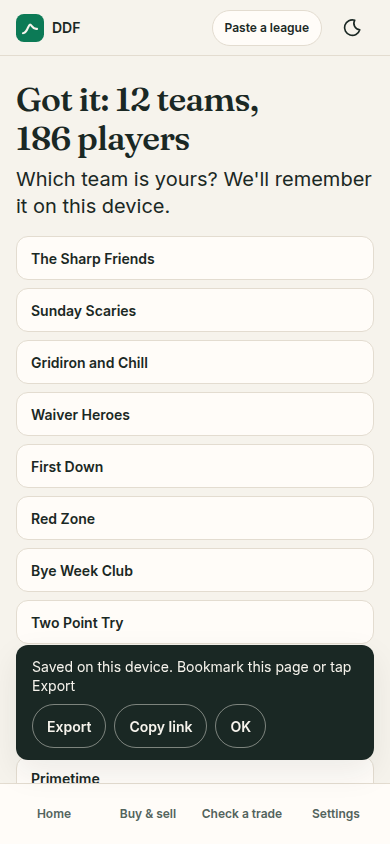
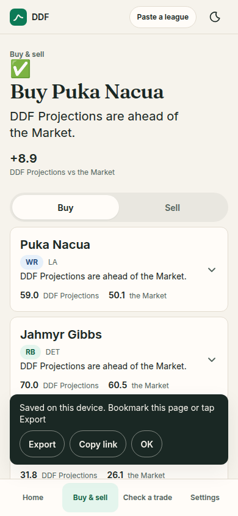
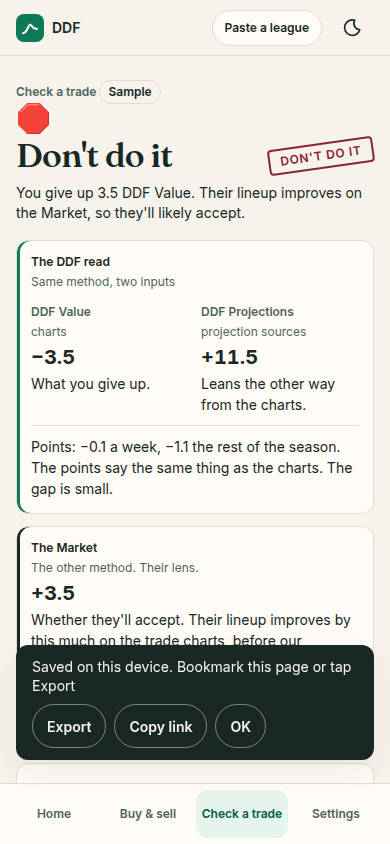
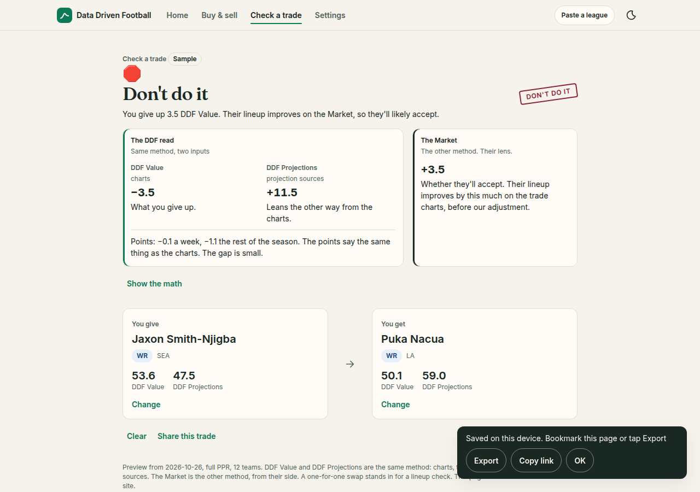
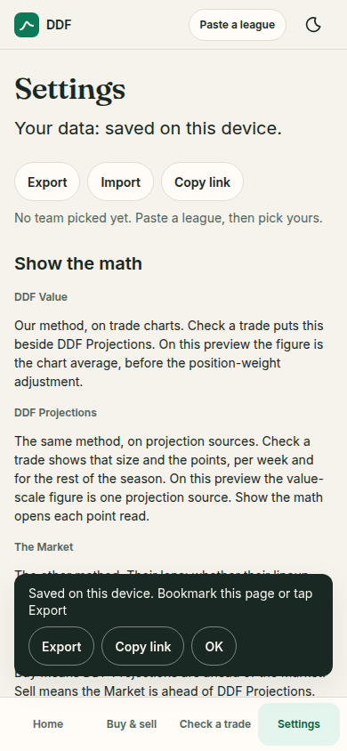

# Design direction, October 2026

Proposal for Jeremy, revised the same day to match decisions he made on 2026-10-26. Nothing here ships. The live site is unchanged. The clickable preview is `app/v2-concept/index.html`. `pipelines/build_v2_page.py` copies a named list of files out of `app/v2/`, so this folder is not part of the publish.

Last updated: 2026-10-26. Status: Proposal.

## Decided

These are locked. The preview is drawn to them.

**Launch has no accounts and no platform integrations.** A league arrives as a paste. One box, and a "Where do I copy it from?" picker that only switches the tip:

- Sleeper: one team per page. Paste a team, then the next. A running count tracks them.
- ESPN: open League, then Rosters. Select all, and copy.
- Yahoo: the rosters page. Select all, and copy.
- Somewhere else: any player list, or typed names.

Then a match check, "Got it: 12 teams, 186 players", then pick your team. That choice is remembered on this device. The toast is "Saved on this device. Bookmark this page or tap Export", with Export and Copy link. Settings says "Your data: saved on this device." with Export, Import, and Copy link.

The hero micro-line is "Free · No sign-up · Nothing to connect · Saved on this device". The button is "Paste my league". The preview never says we support, connect, or sync with Sleeper, ESPN, or Yahoo. Those names are only where the paste is copied from.

**Voice.** The sharp friend in your league chat. Positioning line: "Know who to trade for, before your league does."

**One term per concept.** DDF Value and DDF Projections are the same method on two inputs. DDF Value is that method on trade charts (the average of the indexed, position-weight-adjusted charts). DDF Projections is that method on projection sources. The Market is the competing method, the other team's lens: the indexed trade charts before our adjustment. Buy, Sell, Fair price, Change.

**Nav.** Trade targets is "Buy & sell". Compare is "Check a trade". Overrides is "Settings". Values auditing is "Show the math", a disclosure on Check a trade and a short explainer in Settings. It is not a fifth tab.

**A trade verdict** is an emoji, a headline of at most six words, one line of why, and a numbers chip. The math is behind "Show the math". Fit words are Send it, Worth a shot, They'll pass, Fair swap, and Don't do it.

**Viability.** A trade is good for me when I gain DDF Value, the chart side. The other team is judging whether their lineup improves on the Market. DDF Projections sit in that same read. They do not cast a second vote. The sample gives up 3.5 DDF Value and says "You give up 3.5 DDF Value. Their lineup improves on the Market, so they'll likely accept."

**Casual first, depth one tap away.** Count-up numbers, a verdict stamp, confetti on a big win, and a shareable trade card are in the preview. `prefers-reduced-motion: reduce` turns the duration to 0ms and does not play confetti. Screenshot mode does the same, so a shot is the settled screen.

**Roster counts are league-wide.** The match line says 12 teams and 186 players. The preview does not show a per-team bench or a roster shape.

Marketing copy in the preview does not name chart publishers, and it does not show debug strings.

## The first 10 seconds

On a 390×844 phone, the click-through check puts the headline 107px from the top of the viewport. On a 1280×900 window it is 124px. There is no season banner, no sources bar, and no stack of league controls above it.

1. You read "Free · No sign-up · Nothing to connect · Saved on this device".
2. You read "Know who to trade for, before your league does." and you see "Paste my league".
3. A card on that same screen already has the first answer. In this sample: Buy Puka Nacua, because DDF Projections are ahead of the Market.
4. "I already have a trade" opens Check a trade. The league chip stays one chip. Before a team is picked it says "Paste a league". After that, it is the team name, and it opens Settings.

## The five screens

**Home.** The positioning line, the micro-line, one button, a text link, and a peek of the first answer.

**Paste your league.** The source picker, one tip, one box. On the Sleeper tip, "Add this team" raises the count and "That's everyone" moves on. The other tips use "Check the paste". The next step is the match line and twelve team names. Picking one writes it to this device and shows the toast.

**Buy & sell.** The title is the answer. "Buy Puka Nacua." One line of why, one numbers chip, then Buy and Sell as one control. Each row is a person, a position chip, the same why, and DDF Projections next to the Market. Open a row for the two bars. The green bar is DDF Projections. The ink bar is the Market. On this preview those two can differ. DDF Value, the chart side, is the same chart average as the Market until the position-weight adjustment is wired, so the list does not draw it a second time.

**Check a trade.** The title is the fit word, with a stamp, then one sentence for the viability rule. Under that, two groups. The DDF read puts two numbers side by side and labels them "Same method, two inputs": DDF Value (charts) and DDF Projections (projection sources). Both sizes show. The projection side also shows the points, per week and for the rest of the season. The Market read sits apart, labeled "The other method. Their lens.", and says whether they'll accept. "Show the math" opens the chart average, the value-scale projection, and every point read. The fit word comes from DDF Value against the Market. A lean between the two DDF inputs is a line under the pair, not a second verdict. The sample is Don't do it: you give up 3.5 on the charts, DDF Projections say you gain 11.5 on the value scale, the points move 0.1 a week (1.1 the rest of the season), and they gain 3.5 on the Market. Giving up Jaxon for Jahmyr Gibbs becomes "They'll pass", and both DDF inputs agree. Clear starts from "Add a player to each side." "Share this trade" opens a card you can copy.

**Settings.** The data line and the three actions, then Show the math in plain language: DDF Value, DDF Projections, the Market, Buy, Sell, Fair price, Change, and how a trade is judged.

## Tokens

The type scale is the Figma scale: 34, 28, 20, 14, 12. The answer is 34. A name or the line under the answer is 20. Body is 14. Metadata is 12. The emoji sits at 28. Nothing else.

UI text is Inter. The answer is Fraunces, a soft serif, vendored under the SIL Open Font License (`app/v2-concept/fonts/`). Numbers stay in Inter, tabular.

Spacing steps by 8. Phone page padding is 16. Cards are 12px radius. The main button, the chips, the source picker, and the search field are pills. Hit targets on the preview's buttons are at least 44px.

Color, light:

| Token | Value | Use |
|---|---|---|
| Canvas | `#F6F3EC` | Warm paper |
| Surface | `#FFFCF8` | Cards |
| Ink | `#1A2824` | Text |
| Muted | `#52635C` | Metadata |
| Line | `#E3DCD0` | Hairlines |
| Action | `#0C7A56` | The one button, the DDF Projections bar, and the DDF read's edge |
| Action ink | `#FFFFFF` | Text on that button |

Good, warn, bad, and info are tint plus ink pairs (`#E4F5ED` / `#085C40`, `#F8EFE1` / `#7A4510`, `#F8E8EA` / `#8C2434`, `#E6F0FA` / `#18467A`). Dark mode uses the same roles: canvas `#101614`, surface `#18211D`, ink `#E8F2ED`, action `#6EE4B8` with ink `#062018`.

Position is the same chip with a tone (RB good, WR info, TE warn, QB neutral). The verdict stamp reuses those inks. It is not a second badge.

## Motion

One duration, 200ms, on `cubic-bezier(0.2, 0.7, 0.2, 1)`. A page rises 8px and fades. A card opens by height. The Buy/Sell thumb slides. A button presses in slightly. Hover styles sit inside `@media (hover: hover)`.

On top of that, when motion is allowed: numbers count up over 400ms, the stamp settles, and a Send it with a gain of 8 or more plays a short confetti burst once per trade. The share card is a still card, not an animation. Reduced motion and screenshot mode set the duration to 0ms, skip the count-up, and do not mount confetti. The stylesheet has no `!important`.

## The numbers in the preview

They are real fixture values, and they are not live DDF Value.

`app/v2-concept/build_sample.py` reads `dist/modules/player-trace.json` (generated 2026-10-26) and names, positions, teams, and full-PPR projection points from `data/fixtures/current/players.json`. The chart average is the mean of the four indexed trade charts for full PPR, 12 teams, rounded to one decimal. On this preview that average is both DDF Value (your side of the trade) and the Market (their side). The position-weight adjustment is not in the fixture, so the two are mirrors of one mean until it is wired. DDF Projections on the value scale are one projection source on that same scale, not the three-source adjusted blend. The point sizes are ESPN, CBS rest of season, and Razzball, averaged. Per week is that average. Rest of season is the total still to play. CBS is stored as a per-game rate, so its rest-of-season total is the rate times games remaining. Trade-chart publisher names are not in the sample. The three point reads are, and they appear only under Show the math.

In this sample, Puka Nacua is DDF Projections 59.0 against a Market of 50.1 (8.9 ahead). Chris Olave is 24.4 against 34.6 (10.2 behind). The sample trade gives Jaxon Smith-Njigba (charts 53.6, projection series 47.5, 21.8 points a week, 240.1 the rest of the season) and gets Puka (charts 50.1, projection series 59.0, 21.7 a week, 239.0 the rest of the season). You give up 3.5 DDF Value. DDF Projections say you gain 11.5 on the value scale. The points go with the charts, by 0.1 a week and 1.1 the rest of the season, because ESPN has Puka ahead (23.5 against 20.7 a week) while CBS rest of season and Razzball have Jaxon a little ahead. They gain 3.5 on the Market. A one-for-one on this preview cannot be a gain for you on the charts and a gain for them on the Market at the same time, because those are the two seats of one average. Jahmyr Gibbs sits on the projection ceiling of 70, so his lead is a floor and he is not the featured buy. Quarterbacks are left out. On the 1QB chart scale a raw gap against the projection anchor overstates the lead.

The paste does not parse a league. Any non-empty paste, or "That's everyone" after at least one Sleeper team, shows the decided success line. The twelve team names are sample names for the picker. "Their lineup improves" is a one-for-one Market gain. Show the math says so. A full roster check comes with the live page.

Two cuts exist only so the preview has a calm list and a calm sentence. They are not proposed changes to the trade math:

- Buy and Sell list a player when DDF Projections and the Market differ by at least 2.5. Closer names are Fair price, and they stay in the picker.
- Send it is a chart gain of at least 5 when they improve on the Market. A smaller chart gain that they would still accept is Worth a shot. A chart gain they would not accept is They'll pass. A chart loss of 2 or more is Don't do it. Both sides inside 2 is Fair swap. On this preview a one-for-one chart gain is their Market loss, so Send it waits on the position-weight adjustment.

Regenerate with `python3 app/v2-concept/build_sample.py` from the repo root. Do not hand-edit `sample.js`.

## What this is not

- It does not change `app/v2/shell.html`, `v2.css`, `v2.js`, or the production tab files.
- It does not run the value engine, and it does not mount the hidden legacy engine.
- It does not publish. Opening the file, or serving the repo, is the whole preview.

## Screens

Light shots at 390 and 1280 are in `docs/design/shots/`.

The same folder also has the 1280 shots of the paste flow, the match step, Buy & sell, and Settings.

## Type and canvas

Decided 2026-10-26, when Jeremy left both calls to this pass.

The headline is Fraunces. Everything else, including every number, is Inter. The serif is the one playful note, and the figures stay in the UI face.

The canvas is warm paper, `#F6F3EC`, with the forest ink and green above. Today's mint `#F3F7F7` stays on the live site until a production pass.
